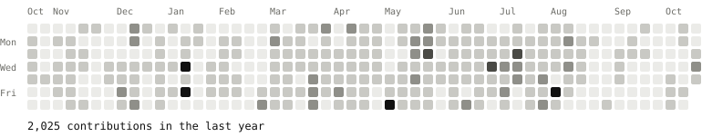

  <picture>
    <source media="(prefers-color-scheme: dark)" srcset="./assets/banner-dark.svg">
    <source media="(prefers-color-scheme: light)" srcset="./assets/banner-light.svg">
    
  </picture>

Full-stack engineer building tools for agents and the web. I work across TypeScript, Rust, and the browser, and most of my open source lives at the intersection of agent workflows, developer tooling, and product interfaces.

## Focus

- **Agents** - skills, proxies, and MCP tooling that make coding agents more useful.
- **Developer tooling** - build systems, Electron and Rspack workflows, and CLIs.
- **Web** - component systems, theme frameworks, and end-to-end product work.

  
  
  
  
  
  
  
  
  

## Selected Work

### Agent

<table>
  <tr>
    <td width="50%" valign="top">
      <h4><a href="https://github.com/guangzan/deepseek-lane">DeepSeek Lane</a></h4>
      
A local proxy that connects Cursor to DeepSeek thinking models and fixes the <code>reasoning_content</code> round-trip.

      
 <code>TypeScript</code>

    </td>
    <td width="50%" valign="top">
      <h4><a href="https://github.com/guangzan/monorail">Monorail</a></h4>
      
Local-first Agent Skills that carry a change from alignment to spec, slice, and shipped code.

      
 <code>Shell</code>

    </td>
  </tr>
  <tr>
    <td width="50%" valign="top">
      <h4><a href="https://github.com/guangzan/things">things</a></h4>
      
An AI-first Things 3 CLI and MCP server for macOS, with typed queries and safe writes.

      
 <code>Rust</code>

    </td>
    <td width="50%" valign="top"></td>
  </tr>
</table>

### Developer Tooling & App

<table>
  <tr>
    <td width="50%" valign="top">
      <h4><a href="https://github.com/guangzan/tona">Tona</a></h4>
      
A modern skin development framework for CNBlogs, with a Vite toolchain, typed options, and 30+ plugins.

      
 <code>TypeScript</code>

    </td>
    <td width="50%" valign="top">
      <h4><a href="https://github.com/guangzan/rselectron">Rselectron</a></h4>
      
An Rspack-first Electron development and build tool with a fast feedback loop.

      
 <code>TypeScript</code>

    </td>
  </tr>
  <tr>
    <td width="50%" valign="top">
      <h4><a href="https://github.com/guangzan/tinytab">Tinytab</a></h4>
      
A browser new-tab extension built with Vue 3, TypeScript, Vite, and Naive UI.

      
 <code>Vue</code>

    </td>
    <td width="50%" valign="top">
      <h4><a href="https://github.com/guangzan/termbio">termbio</a></h4>
      
A CLI tool that prints a personal information card in the terminal.

      
 <code>JavaScript</code>

    </td>
  </tr>
</table>

## Writing

Notes on agents, developer tooling, and the modern web. The latest posts are synced from my [CNBlogs feed](https://www.cnblogs.com/guangzan/rss) every month.

<!-- WRITING:START -->
- **2026-08-13** · [Monorail：对齐 → 规格化 → 切片 → 构建](https://www.cnblogs.com/guangzan/p/22454683)
- **2026-06-24** · [过去三个月对我帮助最大的一个 skill：grill-me](https://www.cnblogs.com/guangzan/p/20774394)
- **2026-05-12** · [DeepSeek-Lane：在 Cursor 内使用 DeepSeek V4 模型](https://www.cnblogs.com/guangzan/p/20022250)
- **2026-03-30** · [Pretext：值得关注的文本排版引擎](https://www.cnblogs.com/guangzan/p/19796050)
- **2026-03-16** · [Vite Plus 迁移记录与踩坑总结](https://www.cnblogs.com/guangzan/p/19719119)
<!-- WRITING:END -->

## Stats

  <picture>
    <source media="(prefers-color-scheme: dark)" srcset="./profile/stats-dark.svg">
    <source media="(prefers-color-scheme: light)" srcset="./profile/stats-light.svg">
    
  </picture>
  <picture>
    <source media="(prefers-color-scheme: dark)" srcset="./profile/top-langs-dark.svg">
    <source media="(prefers-color-scheme: light)" srcset="./profile/top-langs-light.svg">
    
  </picture>

  <picture>
    <source media="(prefers-color-scheme: dark)" srcset="./profile/activity-dark.svg">
    <source media="(prefers-color-scheme: light)" srcset="./profile/activity-light.svg">
    
  </picture>

