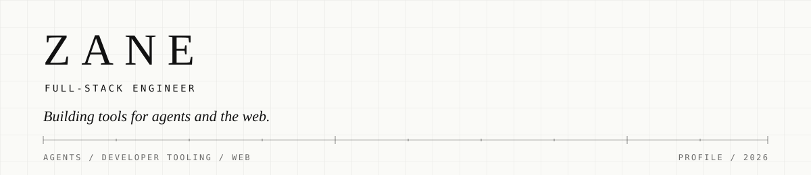

  <picture>
    <source media="(prefers-color-scheme: dark)" srcset="./assets/banner-dark.svg">
    <source media="(prefers-color-scheme: light)" srcset="./assets/banner-light.svg">
    
  </picture>

Full-stack engineer building tools for agents and the web. I work across TypeScript, Rust, and the browser, and most of my open source lives at the intersection of agent workflows, developer tooling, and product interfaces.

  
  
  
  
  
  
  
  
  

## Projects

- **[DeepSeek Lane](https://github.com/guangzan/deepseek-lane)** — A local proxy that connects Cursor to DeepSeek thinking models and fixes the `reasoning_content` round-trip.
- **[Monorail](https://github.com/guangzan/monorail)** — Local-first Agent Skills that carry a change from alignment to spec, slice, and shipped code.
- **[things](https://github.com/guangzan/things)** — An AI-first Things 3 CLI and MCP server for macOS, with typed queries and safe writes.
- **[Tona](https://github.com/guangzan/tona)** — A modern skin development framework for CNBlogs, with a Vite toolchain, typed options, and 30+ plugins.
- **[Rselectron](https://github.com/guangzan/rselectron)** — An Rspack-first Electron development and build tool with a fast feedback loop.
- **[Tinytab](https://github.com/guangzan/tinytab)** — A browser new-tab extension built with Vue 3, TypeScript, Vite, and Naive UI.
- **[termbio](https://github.com/guangzan/termbio)** — A CLI tool that prints a personal information card in the terminal.

## Writing

Notes on agents, developer tooling, and the modern web. The latest posts are synced from my [CNBlogs feed](https://www.cnblogs.com/guangzan/rss) every month.

<!-- WRITING:START -->
- **2026-08-13** · [Monorail：对齐 → 规格化 → 切片 → 构建](https://www.cnblogs.com/guangzan/p/22454683)
- **2026-06-24** · [过去三个月对我帮助最大的一个 skill：grill-me](https://www.cnblogs.com/guangzan/p/20774394)
- **2026-05-12** · [DeepSeek-Lane：在 Cursor 内使用 DeepSeek V4 模型](https://www.cnblogs.com/guangzan/p/20022250)
- **2026-03-30** · [Pretext：值得关注的文本排版引擎](https://www.cnblogs.com/guangzan/p/19796050)
- **2026-03-16** · [Vite Plus 迁移记录与踩坑总结](https://www.cnblogs.com/guangzan/p/19719119)
<!-- WRITING:END -->

## Stats

  <picture>
    <source media="(prefers-color-scheme: dark)" srcset="./profile/stats-dark.svg">
    <source media="(prefers-color-scheme: light)" srcset="./profile/stats-light.svg">
    
  </picture>
  <picture>
    <source media="(prefers-color-scheme: dark)" srcset="./profile/top-langs-dark.svg">
    <source media="(prefers-color-scheme: light)" srcset="./profile/top-langs-light.svg">
    
  </picture>

